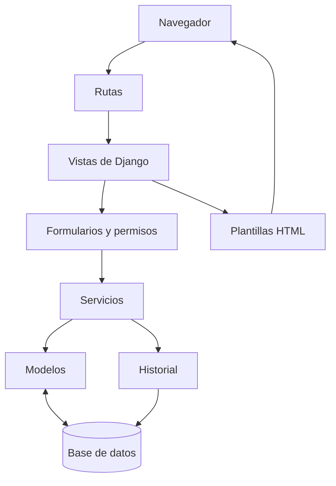

# Arquitectura sencilla del proyecto

El proyecto usa Django con el patrón MVT, equivalente en responsabilidades a MVC.

- Model: `accounts/models.py`, `expenses/models.py`, `ledger/models.py` y `auditlog/models.py`.
- Controller: `accounts/views.py`, `expenses/views.py` y las rutas de `config/urls.py`, `accounts/urls.py` y `expenses/urls.py`. Los servicios contienen los cálculos de negocio.
- View: las plantillas HTML ubicadas en `templates/`.

La separación en aplicaciones permite que cada integrante trabaje en su módulo y luego se integre en el mismo proyecto. No se crean proyectos separados ni se duplican modelos.

## Responsabilidades de los módulos

| Módulo | Responsabilidad |
| --- | --- |
| accounts | Usuarios, autenticación, perfil y límite de intentos de acceso. |
| expenses | Grupos, integrantes, compras, reparto, ajustes y revisiones. |
| ledger | Obligaciones, pagos, saldos y transferencias sugeridas. |
| auditlog | Historial de cambios y datos de anulación. |
| config | Configuración general y rutas del proyecto. |

## Flujo de una solicitud

## Integridad financiera

Las operaciones de escritura relacionadas utilizan transacciones atómicas. Los servicios validan los permisos y bloquean registros del grupo antes de modificar sus obligaciones. Las señales sincronizan las obligaciones con las asignaciones.

Los pagos pendientes reservan el importe disponible. Solo los pagos confirmados afectan los saldos. Las objeciones bloquean los pagos asociados a la compra. Las claves únicas de operación evitan repetir registros y la versión de la compra permite detectar ediciones desactualizadas.

## Presentación

Las plantillas HTML, los estilos CSS y JavaScript forman la interfaz. El formulario de compras separa la captura de datos y la asignación de gastos. La vista previa del reparto es orientativa; el servidor realiza el cálculo definitivo.

## Base de datos y despliegue

SQLite es la base de datos de desarrollo. PostgreSQL es la opción prevista para comprobar la concurrencia con bloqueos de filas reales. SQLite no ofrece el mismo comportamiento de select_for_update.

En producción se debe configurar una clave secreta propia, desactivar DEBUG, configurar los hosts permitidos y preparar la tabla de caché con python manage.py createcachetable.

## Validaciones pendientes

La arquitectura conserva el monolito modular. Todavía se requiere ejecutar las migraciones y pruebas completas, comprobar la concurrencia, medir el RNF-04 y revisar las interfaces frente a Figma. La compensación de deudas indirectas no está implementada como operación financiera.
