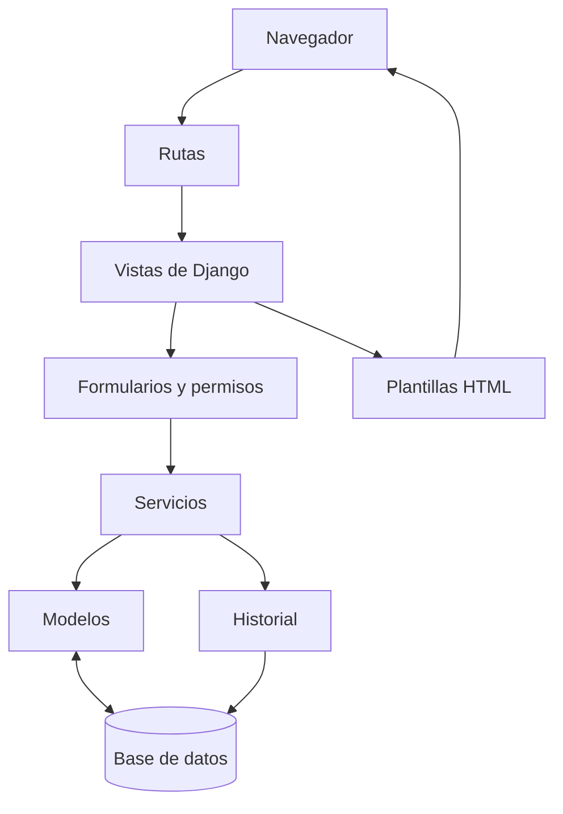

# Arquitectura sencilla del proyecto

El proyecto usa Django con el patrón MVT, equivalente en responsabilidades a MVC.

- Model: `accounts/models.py`, `expenses/models.py`, `ledger/models.py` y `auditlog/models.py`.
- Controller: `accounts/views.py`, `expenses/views.py` y las rutas de `config/urls.py`, `accounts/urls.py` y `expenses/urls.py`. Los servicios contienen los cálculos de negocio.
- View: las plantillas HTML ubicadas en `templates/`.

La separación en aplicaciones permite que cada integrante trabaje en su módulo y luego se integre en el mismo proyecto. No se crean proyectos separados ni se duplican modelos.

## Responsabilidades de los módulos

| Módulo | Responsabilidad |
| --- | --- |
| accounts | Usuarios, autenticación, perfil y límite de intentos de acceso. |
| expenses | Grupos, integrantes, compras, reparto, ajustes y revisiones. |
| ledger | Obligaciones, pagos, saldos, transferencias sugeridas y compensaciones. |
| auditlog | Historial de cambios y datos de anulación. |
| config | Configuración general y rutas del proyecto. |

## Flujo de una solicitud

## Integridad financiera

Las operaciones de escritura relacionadas utilizan transacciones atómicas. Los servicios validan los permisos y bloquean registros del grupo antes de modificar sus obligaciones. Las señales sincronizan las obligaciones con las asignaciones.

Los pagos pendientes reservan el importe disponible. Solo los pagos confirmados afectan los saldos. Las objeciones bloquean los pagos asociados a la compra. Las claves únicas de operación evitan repetir registros y la versión de la compra permite detectar ediciones desactualizadas.

## Compensaciones indirectas

El servicio ledger/services/compensaciones.py coordina las solicitudes, reservas, aprobaciones, cancelaciones y confirmación final. simplificacion.py busca una cadena mediante BFS. obligaciones.py descuenta las reservas al registrar pagos y saldos.py contabiliza únicamente compensaciones aplicadas.

Los modelos Compensacion, AprobacionCompensacion y TramoCompensacion conservan el estado, los participantes y las obligaciones originales. El bloqueo del grupo coordina las escrituras de los servicios. La fecha de aplicación se registra cuando el acreedor confirma la recepción. La confirmación no consulta una entidad bancaria.

Las vistas y rutas de expenses conectan estos servicios con el dashboard, pagos y la plantilla de compensaciones. El historial registra las transiciones. La reversión de una compensación aplicada no está implementada.

## Presentación

Las plantillas HTML, los estilos CSS y JavaScript forman la interfaz. El formulario de compras separa la captura de datos y la asignación de gastos. La vista previa del reparto es orientativa; el servidor realiza el cálculo definitivo.

## Base de datos y despliegue

SQLite es la base de datos de desarrollo. PostgreSQL es la opción prevista para comprobar la concurrencia con bloqueos de filas reales. SQLite no ofrece el mismo comportamiento de select_for_update.

En producción se debe configurar una clave secreta propia, desactivar DEBUG, configurar los hosts permitidos y preparar la tabla de caché con python manage.py createcachetable.

## Validaciones pendientes

El cálculo de saldos incorpora dos consultas agrupadas adicionales para las compensaciones aplicadas. Las pruebas esperan ocho consultas en total, independientemente de la cantidad de integrantes; esta expectativa aún no se ha ejecutado. Los seis casos nuevos de compensaciones verifican el flujo y sus permisos una vez ejecutados.

La arquitectura conserva el monolito modular. Todavía se requiere ejecutar las migraciones y pruebas completas, comprobar la concurrencia, medir el RNF-04 y revisar las interfaces frente a Figma. La compensación indirecta está incorporada en el código, pero su funcionamiento, concurrencia y efecto contable todavía deben comprobarse con pruebas.
