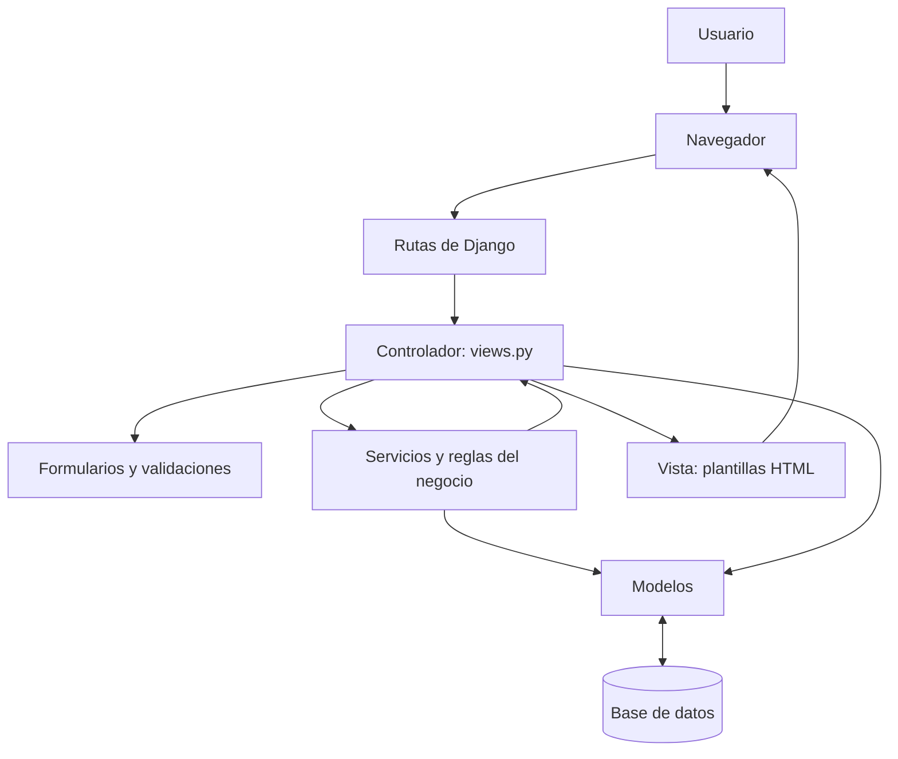
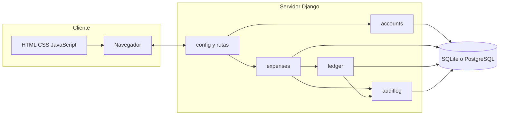
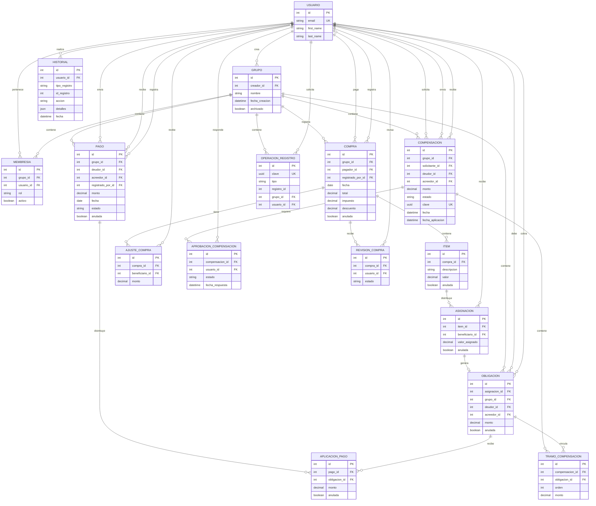
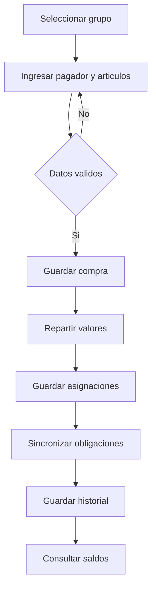
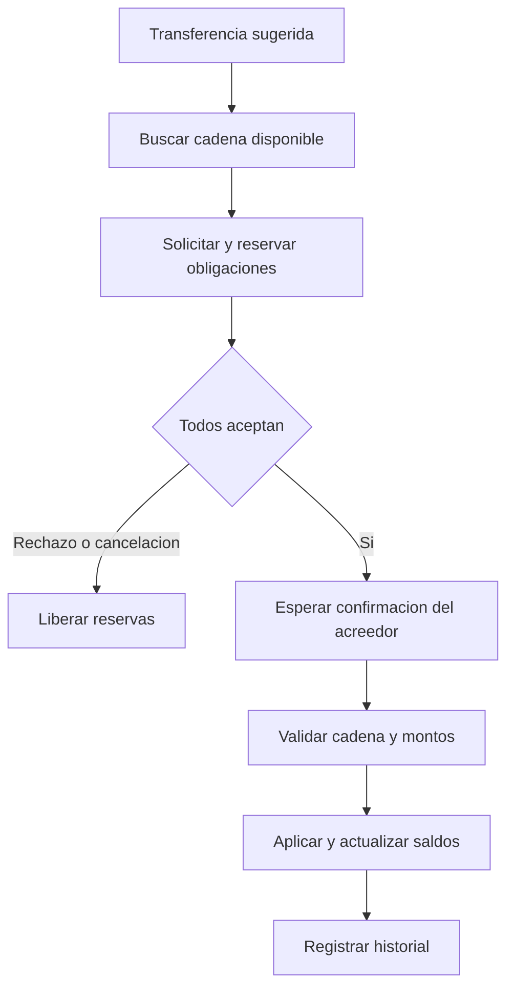

# ¿Quién Gastó Esto?

## Descripción del proyecto

¿Quién Gastó Esto? es una aplicación web que desarrollamos para organizar los gastos compartidos entre varias personas. La idea es que un grupo pueda registrar sus compras, identificar quién pagó, repartir los valores y consultar cuánto debe o cuánto tiene a favor cada integrante, sin tener que hacer las cuentas manualmente.

Puede utilizarse para gastos de una vivienda, viajes, reuniones o compras entre amigos.

## Objetivo

Facilitar el control de los gastos compartidos, mantener un historial de los movimientos y mostrar de forma clara las cuentas pendientes de cada persona.

## Funcionalidades

| Funcionalidad | Descripción |
| --- | --- |
| Cuenta personal | Registro, inicio y cierre de sesión, edición del perfil y cambio de contraseña. |
| Grupos | Creación, edición del nombre y archivado seguro de grupos. |
| Integrantes | Incorporación, administración de roles y retiro condicionado al estado financiero. |
| Compras | Registro de quién pagó, fecha, descripción y artículos de una compra. |
| Reparto | Distribución de artículos entre todos, una persona o gastos de mascota compartidos. |
| Saldos | Consulta del dinero a favor y de las deudas pendientes. |
| Pagos | Registro de pagos directos, confirmación o rechazo por el acreedor y anulación según permisos. |
| Revisiones | Aceptación u objeción de compras por los integrantes afectados. |
| Compensaciones | Solicitud, aprobación de participantes y confirmación de recepción de pagos indirectos. |
| Historial | Consulta de cambios y anulaciones por grupo. |
| Dashboard | Resumen de saldos, transferencias sugeridas y movimientos recientes. |

## Tecnologías utilizadas

- Python: lenguaje con el que desarrollamos la lógica.
- Django 5.2: framework que conecta las páginas, los datos y las funcionalidades.
- SQLite: base de datos predeterminada. La configuración también contempla PostgreSQL, cuyo uso requiere el controlador correspondiente.
- HTML, CSS y JavaScript: estructura, diseño e interacción de las páginas.
- Git y GitHub: organización del trabajo y control de versiones.

## Instalación local en Windows

Desde PowerShell, dentro de la carpeta que contiene manage.py:

```powershell
python -m venv .venv
.\.venv\Scripts\python.exe -m pip install -r requirements.txt
.\.venv\Scripts\python.exe manage.py migrate
.\.venv\Scripts\python.exe manage.py runserver
```

Abre http://127.0.0.1:8000/ en el navegador. Para detener el servidor utiliza Ctrl+C. No es necesario instalar otro framework ni configurar PostgreSQL para el desarrollo local.

Si ya tienes una base de datos, sigue primero las instrucciones de actualización de este documento.

### Variables de entorno

| Variable | Uso |
| --- | --- |
| DJANGO_DEBUG | True para desarrollo; False para producción. |
| DJANGO_SECRET_KEY | Clave privada y estable, obligatoria en producción. |
| DJANGO_ALLOWED_HOSTS | Dominios permitidos separados por comas. |
| DB_ENGINE | sqlite por defecto; postgresql como opción existente. |

Sin una clave configurada en desarrollo, Django genera una al iniciar el proceso y las sesiones pueden dejar de ser válidas al reiniciar. No publiques claves ni contraseñas en GitHub. La configuración de producción exige HTTPS y una tabla de caché.

## Arquitectura del sistema

Trabajamos con una arquitectura MVC dentro de un monolito modular. Esto significa que tenemos un solo proyecto dividido en módulos que cumplen diferentes responsabilidades. Django utiliza el patrón MVT, que en nuestro proyecto se relaciona con MVC de la siguiente manera:

| MVC | En Django | Responsabilidad |
| --- | --- | --- |
| Modelo | models.py | Representa y guarda la información. |
| Vista | templates | Muestra la información al usuario. |
| Controlador | urls.py y views.py | Recibe las solicitudes y coordina las respuestas. |
| Apoyo a la lógica | services y forms | Realiza cálculos, aplica reglas y valida los datos. |

### Diagrama de arquitectura MVC



### Infraestructura lógica



Este diagrama representa los componentes del proyecto, no una infraestructura de alojamiento que hayamos verificado en producción.

## Estructura del código

```text
Administracion/
├── accounts/
│   ├── models.py
│   ├── forms.py
│   ├── views.py
│   ├── urls.py
│   ├── migrations/
│   └── tests/
├── expenses/
│   ├── models.py
│   ├── forms.py
│   ├── views.py
│   ├── urls.py
│   ├── signals.py
│   ├── services/
│   ├── migrations/
│   └── tests/
├── ledger/
│   ├── models.py
│   ├── services/
│   ├── migrations/
│   └── tests/
├── auditlog/
│   ├── models.py
│   ├── services.py
│   └── migrations/
├── config/
│   ├── settings.py
│   ├── urls.py
│   ├── asgi.py
│   └── wsgi.py
├── templates/
│   ├── accounts/
│   ├── expenses/
│   ├── registration/
│   ├── base.html
│   └── inicio.html
├── static/
│   ├── css/app.css
│   └── js/
│       ├── compra.js
│       ├── compra_editar.js
│       └── confirmaciones.js
├── manage.py
├── requirements.txt
├── ARQUITECTURA.md
└── README.md
```

## Módulos del proyecto

### accounts

Se encarga de los usuarios y de sus datos personales. Utilizamos el correo electrónico como identificador para iniciar sesión. Los formularios validan los datos y Django administra las contraseñas y sesiones.

### expenses

Es el módulo principal de gastos. Contiene los grupos, membresías, compras, artículos y asignaciones.

| Archivo de servicios | Función |
| --- | --- |
| compras.py | Creación de grupos, integrantes y compras. |
| reparto.py | Distribución de los valores entre beneficiarios. |
| permisos.py | Validación de integrantes y roles. |
| registros.py | Edición y anulación de compras y artículos. |
| ajustes.py | Distribución de impuestos y descuentos. |

El archivo signals.py sincroniza las obligaciones cuando se guardan asignaciones y protege aquellas que tienen abonos aplicados.

### ledger

Se encarga de las cuentas entre integrantes.

| Archivo | Función |
| --- | --- |
| saldos.py | Calcula cuánto debe o tiene a favor cada usuario. |
| obligaciones.py | Registra, actualiza y anula pagos y sus abonos. |
| simplificacion.py | Propone transferencias y busca cadenas de obligaciones mediante BFS. |
| compensaciones.py | Solicita, aprueba, cancela y aplica compensaciones indirectas. |

Las transferencias sugeridas no crean pagos automáticamente ni modifican los saldos.

### auditlog

Conserva el historial de acciones y los datos de anulación. Así podemos conocer quién realizó un cambio y cuándo ocurrió. Los registros anulados no se eliminan necesariamente de la base de datos.

### config, templates y static

Config contiene la configuración general, las rutas y los puntos de entrada del servidor. Templates reúne las páginas HTML. Static contiene los estilos y el JavaScript que apoya el formulario de compras.

## Base de datos

Las entidades principales son:

| Entidad | Información que guarda |
| --- | --- |
| Usuario | Correo, nombre y datos de autenticación. |
| Grupo | Nombre, creador, fecha de creación y estado de archivado. |
| Membresia | Usuario, grupo, rol y estado activo. |
| Compra | Grupo, pagador, fecha, total, impuesto y descuento. |
| Item | Artículo de una compra y su valor. |
| Asignacion | Parte del valor que corresponde a un beneficiario. |
| AjusteCompra | Valor de ajuste asignado a un beneficiario. |
| Obligacion | Deuda asociada a una asignación. |
| Pago | Transferencia entre deudor y acreedor, con estado pendiente, confirmado o rechazado. |
| RevisionCompra | Estado de revisión de una compra por cada usuario afectado. |
| OperacionRegistro | Clave única para evitar registros duplicados de compras y pagos. |
| AplicacionPago | Parte de un pago aplicada a una obligación. |
| Compensacion | Grupo, solicitante, deudor, acreedor, monto, estado, clave y fechas. |
| AprobacionCompensacion | Respuesta individual y fecha de cada participante. |
| TramoCompensacion | Obligación original, orden y monto reservado o aplicado. |
| Historial | Usuario, acción, registro afectado, detalles y fecha. |

### Diagrama entidad-relación

El siguiente diagrama muestra las relaciones principales de los modelos propios del proyecto. No incluye todas las tablas internas de autenticación de Django ni los campos de auditoría repetidos.



Historial identifica el registro afectado mediante su tipo e identificador, no mediante una llave foránea a cada tabla. OperacionRegistro también identifica la compra o el pago mediante tipo y registro_id. RevisionCompra tiene una restricción única por compra y usuario.

## Funcionamiento de una compra




## Cálculo de saldos

El saldo tiene en cuenta las compras pagadas, los gastos y ajustes asignados, los pagos confirmados enviados y recibidos, y las compensaciones aplicadas enviadas y recibidas. Las reservas pendientes no cambian el saldo neto.

- Positivo: el integrante tiene dinero a favor.
- Negativo: el integrante tiene dinero pendiente por pagar.
- Cero: su saldo está equilibrado.

## Seguridad e integridad de los datos

Se requiere iniciar sesión para consultar los grupos. Los permisos dependen de la pertenencia al grupo y del rol del usuario. Los formularios validan los datos, los modelos tienen restricciones para evitar valores incorrectos y las operaciones relacionadas utilizan transacciones para evitar registros incompletos. Las anulaciones conservan información para poder revisar los cambios.

## Reglas de seguridad financiera

- Los pagos pendientes reservan el monto, pero solo los confirmados modifican los saldos.
- Las compras objetadas no admiten nuevos pagos asociados hasta resolver la objeción.
- Las compras con abonos pendientes o confirmados no se pueden modificar ni anular libremente.
- El retiro y archivado requieren resolver las obligaciones y revisiones pendientes.
- Las claves únicas de operación evitan repetir el registro de una misma compra o pago.
- Las compensaciones pendientes o aprobadas reservan obligaciones; solo las aplicadas modifican saldos.
- Todos los participantes deben aprobar y el acreedor debe confirmar la recepción del dinero.
- Las compras vinculadas y los retiros o archivados con solicitudes activas tienen restricciones adicionales.

## Funcionamiento de una compensación



La búsqueda BFS utiliza una sola cadena capaz de cubrir el monto completo. No combina varias cadenas. La compensación aplicada reduce cada obligación de la cadena y ajusta el saldo neto de los extremos una sola vez, sin crear un pago directo adicional. La confirmación es manual, no bancaria. No existe todavía una operación de reversión de compensaciones aplicadas.

## Rendimiento

El proyecto utiliza consultas agrupadas para calcular los saldos, relaciones cargadas junto con los registros principales e índices en campos de búsqueda frecuente. El dashboard limita las compras, pagos y compensaciones recientes y combina sus resultados. El rendimiento de las consultas adicionales de compensación aún debe medirse.

## Actualización de una instalación existente

Antes de actualizar una base de datos con información real, realiza una copia de seguridad. En un entorno de prueba ejecuta:

```bash
python manage.py check
python manage.py makemigrations --check --dry-run
python manage.py showmigrations
python manage.py migrate --plan
python manage.py migrate
python manage.py test
```

Las migraciones nuevas agregan el estado de archivado, las claves únicas de operación, las revisiones de compras, la autorización de datos personales, el estado de los pagos y las tablas de compensaciones con su fecha de aplicación. Los grupos existentes conservan el estado activo y los pagos anteriores quedan confirmados por defecto para conservar el cálculo histórico. No se generan revisiones retroactivas de compras existentes. La migración accounts/0003_usuario_correo_unico.py comprueba los correos duplicados sin distinguir mayúsculas antes de añadir la restricción; si encuentra duplicados, se detiene sin eliminar cuentas.

En producción, con la configuración de caché de base de datos, ejecuta también python manage.py createcachetable. Comprueba primero los resultados en una copia de la base de datos.

## Pruebas unitarias

Con el entorno virtual activo:

```powershell
python manage.py test accounts.tests.test_auth -v 2
python manage.py test ledger.tests.test_compensaciones -v 2
python manage.py test ledger.tests.test_saldos -v 2
python manage.py test ledger.tests.test_obligaciones -v 2
python manage.py test -v 2
```

Los seis casos de compensación cubren reservas, aprobación y confirmación, rechazo, cancelación, solicitudes duplicadas y acceso externo. El cálculo de saldos tiene una expectativa de ocho consultas agrupadas, pendiente de verificar mediante las pruebas. Django utiliza una base de datos de prueba separada.

## Estado de validación

Las pruebas nuevas de seguridad, edición, pagos y rendimiento están incorporadas, pero todavía no se ha ejecutado la suite completa de esta versión. El cumplimiento del RNF-04 (menos de dos segundos con 20 integrantes y 1000 compras) requiere medición. La equivalencia visual con Figma también requiere revisión en navegador.

## Organización del trabajo

El equipo trabaja en un único proyecto. Las ramas permiten organizar los aportes de los integrantes y conservar el historial. La integración final en main se realizará cuando el equipo revise y apruebe los cambios.

## Conclusión

Con esta aplicación buscamos que organizar los gastos de un grupo sea más sencillo y que cada integrante pueda conocer sus cuentas sin depender de cálculos manuales. La separación de responsabilidades nos permite mejorar cada módulo sin tener que cambiar toda la aplicación.
