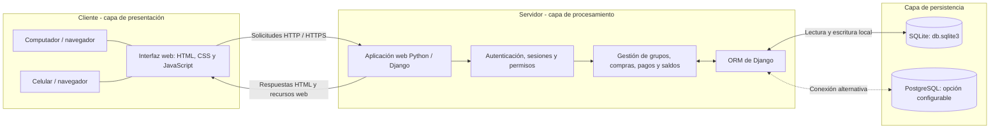
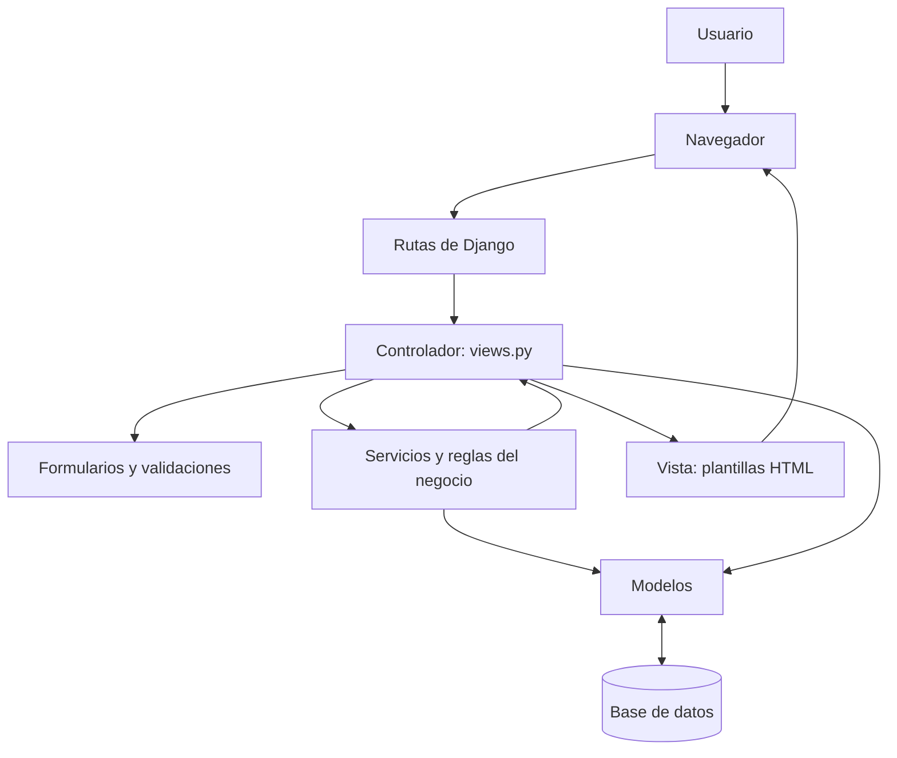
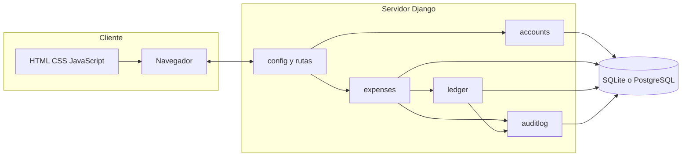
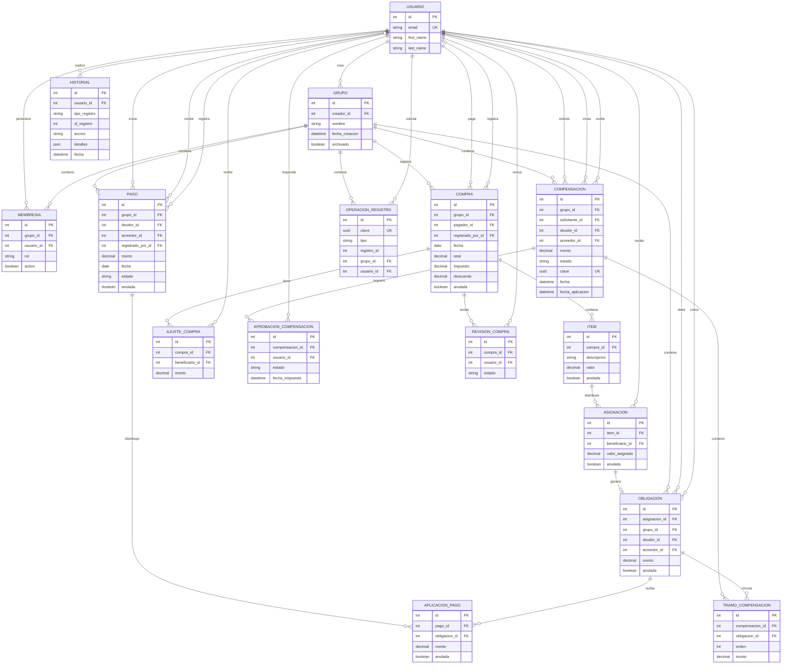

# Arquitectura y módulos

## Arquitectura del sistema: cliente-servidor

La aplicación utiliza una arquitectura cliente-servidor con tres capas lógicas: presentación, procesamiento y persistencia. Los usuarios acceden desde el navegador de un computador o celular. El servidor Django recibe las solicitudes HTTP, valida los permisos, ejecuta las reglas del negocio y consulta o modifica la base de datos mediante el ORM. Devuelve páginas HTML al navegador.

### Diagrama de arquitectura del sistema

| Componente | Responsabilidad |
| --- | --- |
| Cliente | Presentar la interfaz, capturar datos y enviar solicitudes. |
| Servidor | Autenticar usuarios, validar datos, ejecutar cálculos y generar respuestas. |
| Persistencia | Almacenar usuarios, grupos, compras, obligaciones, pagos e historial. |

El navegador no accede directamente a la base de datos. SQLite es la opción predeterminada y se ejecuta dentro del entorno del servidor, sin un servidor de base de datos independiente. PostgreSQL es una alternativa prevista en la configuración, no una segunda base utilizada simultáneamente. Las tres capas son lógicas y no implican tres máquinas físicas. HTTP se utiliza en desarrollo local y HTTPS es obligatorio con la configuración de producción. No se presupone un proveedor de alojamiento ni un despliegue de producción verificado.

## Arquitectura de software: monolito modular MVC/MVT

Trabajamos con una arquitectura MVC dentro de un monolito modular. Esto significa que tenemos un solo proyecto dividido en módulos que cumplen diferentes responsabilidades. Django utiliza el patrón MVT, que en nuestro proyecto se relaciona con MVC de la siguiente manera:

| MVC | En Django | Responsabilidad |
| --- | --- | --- |
| Modelo | models.py | Representa y guarda la información. |
| Vista | templates | Muestra la información al usuario. |
| Controlador | urls.py y views.py | Recibe las solicitudes y coordina las respuestas. |
| Apoyo a la lógica | services y forms | Realiza cálculos, aplica reglas y valida los datos. |

### Diagrama de arquitectura MVC

### Diagrama de componentes internos del software

Este diagrama representa los componentes del proyecto, no una infraestructura de alojamiento que hayamos verificado en producción.

## Arquitectura de base de datos

Las entidades principales son:

| Entidad | Información que guarda |
| --- | --- |
| Usuario | Correo, nombre y datos de autenticación. |
| Grupo | Nombre, creador, fecha de creación y estado de archivado. |
| Membresia | Usuario, grupo, rol y estado activo. |
| Compra | Grupo, pagador, fecha, total, impuesto y descuento. |
| Item | Artículo de una compra y su valor. |
| Asignacion | Parte del valor que corresponde a un beneficiario. |
| AjusteCompra | Valor de ajuste asignado a un beneficiario. |
| Obligacion | Deuda asociada a una asignación. |
| Pago | Transferencia entre deudor y acreedor, con estado pendiente, confirmado o rechazado. |
| RevisionCompra | Estado de revisión de una compra por cada usuario afectado. |
| OperacionRegistro | Clave única para evitar registros duplicados de compras y pagos. |
| AplicacionPago | Parte de un pago aplicada a una obligación. |
| Compensacion | Grupo, solicitante, deudor, acreedor, monto, estado, clave y fechas. |
| AprobacionCompensacion | Respuesta individual y fecha de cada participante. |
| TramoCompensacion | Obligación original, orden y monto reservado o aplicado. |
| Historial | Usuario, acción, registro afectado, detalles y fecha. |

### Diagrama entidad-relación

El siguiente diagrama muestra las relaciones principales de los modelos propios del proyecto. No incluye todas las tablas internas de autenticación de Django ni los campos de auditoría repetidos.

Historial identifica el registro afectado mediante su tipo e identificador, no mediante una llave foránea a cada tabla. OperacionRegistro también identifica la compra o el pago mediante tipo y registro_id. RevisionCompra tiene una restricción única por compra y usuario.
